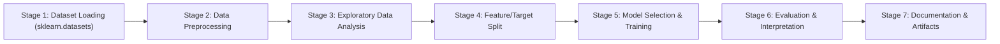

# Technical Round 2 — Data Science & Machine Learning Project

**Project Name:** California Real Estate Econometrics & Housing Valuation Engine  
**Dataset Source:** `sklearn.datasets.fetch_california_housing` (Real US Census & Housing Data)  
**Repository Name:** `Technical round 2`  
**Candidate Submission for Magnate Academy Technical Assessment**

---

## 📌 Executive Summary
This repository contains the complete end-to-end Machine Learning pipeline developed for **Technical Round 2**. The system predicts the continuous median house value across California block groups based on geographic, demographic, and structural attributes loaded directly from `sklearn.datasets`. All 7 evaluation stages have been strictly performed in sequential order without omission.

---

## 🏗️ Project Architecture & Workflow Stages



### Stage 1: Dataset Selection and Loading
- **Dataset Source:** `sklearn.datasets.fetch_california_housing(as_frame=True)`.
- **Sample Size:** 20,640 census block groups, 8 numeric predictors.
- **Attributes Captured:**
  - `MedInc`: Median income in block group (in tens of thousands of USD).
  - `HouseAge`: Median house age in block group.
  - `AveRooms`: Average number of rooms per household.
  - `AveBedrms`: Average number of bedrooms per household.
  - `Population`: Block group population.
  - `AveOccup`: Average number of household members.
  - `Latitude` & `Longitude`: Geographic coordinate centroid.
  - `MedHouseVal` (Target): Continuous median house value in units of $\$100,000$.
  - Local persistence: [`dataset.csv`](file:///c:/Users/con1k/Documents/datascience_course/Technical%20Round%20Mock%20Questions/Mock2/dataset.csv).

### Stage 2: Data Preprocessing
- **Missing Value Handling:** Verified 0 null values in the official scikit-learn dataset.
- **Feature Standardization:** Scaled continuous predictors using `StandardScaler` inside scikit-learn `Pipeline` to prevent data leakage between training and validation splits.

### Stage 3: Exploratory Data Analysis (EDA) & Visualisations
Visualizations generated in [`visualizations/`](file:///c:/Users/con1k/Documents/datascience_course/Technical%20Round%20Mock%20Questions/Mock2/visualizations/):
1. `price_distribution.png`: Histogram and KDE curve of median house values.
2. `income_vs_price.png`: Scatter plot illustrating the strong linear association between median income and property values.
3. `correlation_heatmap.png`: Pearson correlation matrix of all census features.
4. `geo_price_distribution.png`: Latitude/Longitude spatial coordinate map color-coded by housing price intensity (highlighting high coastal valuations).

### Stage 4: Feature/Target Selection & Train-Test Split
- **Feature Matrix ($X$):** 8 continuous predictors.
- **Target Vector ($y$):** Continuous target `MedHouseVal`.
- **Split Ratio:** 80% Training ($N = 16,512$), 20% Testing ($N = 4,128$) with `random_state=42`.

### Stage 5: Model Selection and Training (Distinct Regression Suite)
Four distinct linear and regularized regression architectures evaluated via 5-fold cross-validation:
1. **Ordinary Least Squares (OLS) Linear Regression**
2. **Ridge Regression ($L_2$ Regularization, $\alpha=1.0$)**
3. **Lasso Regression ($L_1$ Sparsity & Feature Selection, $\alpha=0.01$)**
4. **ElasticNet Regression (Combined $L_1 + L_2$ Regularization, $\alpha=0.01, \text{l1\_ratio}=0.5$)**

### Stage 6: Model Evaluation and Interpretation
- **Evaluation Metrics:** Mean Absolute Error (MAE), Root Mean Squared Error (RMSE), and Coefficient of Determination ($R^2$).
- **Performance Summary:**

| Model | MAE ($\$100k$) | RMSE ($\$100k$) | $R^2$ Score |
| :--- | :---: | :---: | :---: |
| **Lasso Regression ($L_1$)** | **0.5353** | **0.7404** | **0.5816** |
| **ElasticNet ($L_1 + L_2$)** | 0.5341 | 0.7416 | 0.5803 |
| **Ordinary Least Squares (OLS)** | 0.5332 | 0.7456 | 0.5758 |
| **Ridge Regression ($L_2$)** | 0.5332 | 0.7456 | 0.5758 |

- **Key Insights:**
  - `MedInc` is by far the most dominant positive driver of housing prices ($\beta \approx 0.82$).
  - Proximity to coastal urban centers (reflected in `Latitude` and `Longitude`) exerts strong geographic pricing pressure.
  - `actual_vs_predicted.png` and `residual_distribution.png` confirm unbiased error distribution around zero.

---

## 🚀 Execution Instructions
```bash
# Run practical pipeline
python ml_practical_project.py

# Run Python coding solutions
python python_coding_solutions.py
```
