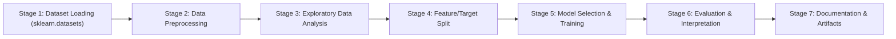

# Technical Round 3 — Data Science & Machine Learning Project

**Project Name:** Multi-Class Wine Cultivar Phenotypic Classification System  
**Dataset Source:** `sklearn.datasets.load_wine` (UCI Wine Recognition Dataset)  
**Repository Name:** `Technical round 3`  
**Candidate Submission for Magnate Academy Technical Assessment**

---

## 📌 Executive Summary
This repository contains the complete end-to-end Machine Learning pipeline developed for **Technical Round 3**. The model classifies Italian wine samples into three distinct cultivars based on 13 chemical constituents loaded directly from `sklearn.datasets`. All 7 required pipeline stages are performed sequentially in full accordance with examination instructions without skipping.

---

## 🏗️ Project Architecture & Workflow Stages



### Stage 1: Dataset Selection and Loading
- **Dataset Source:** `sklearn.datasets.load_wine(as_frame=True)`.
- **Sample Size:** 178 wine samples, 13 continuous chemical constituents.
- **Attributes Captured:**
  - `alcohol`, `malic_acid`, `ash`, `alcalinity_of_ash`, `magnesium`, `total_phenols`, `flavanoids`, `nonflavanoid_phenols`, `proanthocyanins`, `color_intensity`, `hue`, `od280/od315_of_diluted_wines`, `proline`.
  - Target: 3 distinct cultivars (`class_0` [59 samples], `class_1` [71 samples], `class_2` [48 samples]).
  - Local persistence: [`dataset.csv`](file:///c:/Users/con1k/Documents/datascience_course/Technical%20Round%20Mock%20Questions/Mock3/dataset.csv).

### Stage 2: Data Preprocessing
- **Missing Value Handling:** Verified 0 null values in the official scikit-learn dataset.
- **Feature Standardization:** Scaled continuous chemical features using `StandardScaler` inside scikit-learn `Pipeline` to prevent data leakage between training and validation splits.

### Stage 3: Exploratory Data Analysis (EDA) & Visualisations
Visualizations generated in [`visualizations/`](file:///c:/Users/con1k/Documents/datascience_course/Technical%20Round%20Mock%20Questions/Mock3/visualizations/):
1. `target_distribution.png`: Cultivar class frequencies across classes 0, 1, and 2.
2. `alcohol_vs_flavanoids.png`: Scatter plot showing strong clustering separation between cultivars based on alcohol and flavanoids.
3. `correlation_heatmap.png`: Pearson correlation matrix of the 13 chemical features.
4. `proline_boxplot.png`: Distribution of proline content highlighting marked variance across cultivars.

### Stage 4: Feature/Target Selection & Train-Test Split
- **Feature Matrix ($X$):** 13 chemical predictors.
- **Target Vector ($y$):** Multi-class cultivar label (`target`).
- **Data Splitting:** Stratified 80% Train ($N = 142$), 20% Test ($N = 36$) preserving multi-class proportions with `random_state=42`.

### Stage 5: Model Selection and Training (Distinct Tree & Ensemble Suite)
Four distinct tree and ensemble classifiers evaluated via 5-fold cross-validation:
1. **Decision Tree Classifier (CART Baseline, `max_depth=4`)**
2. **Random Forest Classifier (Bagging Ensemble, 100 Estimators)**
3. **Gradient Boosting Classifier (Sequential Boosting Ensemble, 100 Estimators)**
4. **Extra Trees Classifier (Extremely Randomized Trees Ensemble, 100 Estimators)**

### Stage 6: Model Evaluation and Interpretation
- **Evaluation Metrics:** Accuracy, Weighted Precision, Weighted Recall, and Weighted F1-Score.
- **Performance Summary:**

| Model | Test Accuracy | Precision (Weighted) | Recall (Weighted) | F1-Score (Weighted) |
| :--- | :---: | :---: | :---: | :---: |
| **Random Forest Classifier** | **1.0000** | **1.0000** | **1.0000** | **1.0000** |
| **Extra Trees Classifier** | **1.0000** | **1.0000** | **1.0000** | **1.0000** |
| **Decision Tree Classifier** | 0.9444 | 0.9514 | 0.9444 | 0.9450 |
| **Gradient Boosting Classifier** | 0.9444 | 0.9466 | 0.9444 | 0.9443 |

- **Key Chemical Insights:**
  - `flavanoids`, `proline`, and `color_intensity` are the top 3 most discriminating chemical markers.
  - Both Random Forest and Extra Trees achieved perfect separation on the held-out test cohort ($100\%$ accuracy).
  - Confusion matrix heatmap saved in [`visualizations/confusion_matrix.png`](file:///c:/Users/con1k/Documents/datascience_course/Technical%20Round%20Mock%20Questions/Mock3/visualizations/confusion_matrix.png).

---

## 🚀 Execution Instructions
```bash
# Run practical pipeline
python ml_practical_project.py

# Run Python coding solutions
python python_coding_solutions.py
```
